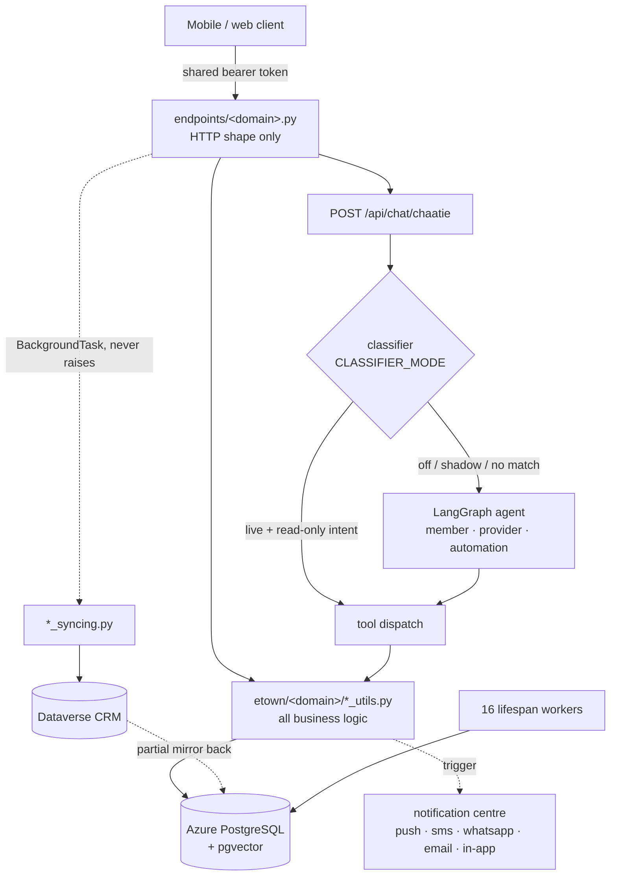
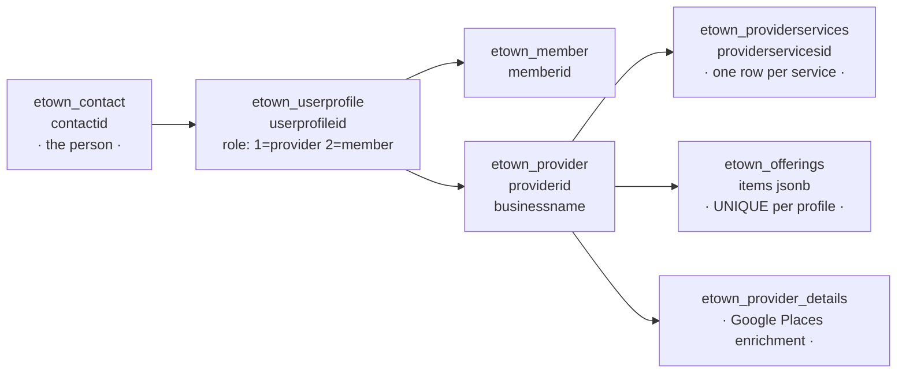

# Etown Agents API

FastAPI backend for **Etown**, a local service marketplace. Members find and book service providers; providers manage listings, offers and bookings. The API hosts a LangGraph conversational agent ("Chaatie"), pgvector semantic search, a multi-channel notification centre, and a background mirror into Microsoft Dataverse (the legacy CRM).

Python 3.11 · FastAPI · asyncpg over Azure PostgreSQL + pgvector · Azure OpenAI + Google Gemini.

## What it does

Etown connects members to local service providers. This repository is the backend for both sides of that marketplace plus the conversational agent that sits over it.

**For members** — semantic and exact-name search across providers, members and towns (`/api/search`); enquiries and bookings with an additional-info round trip (`/api/book`); post-service ratings; collections and favourites; MyCircle (a personal network of providers, built through invitations); a social feed with posts, likes and comments (`/api/feeds`); groups; direct messages (`/api/message`); voice and video calls via 100ms.live (`/api/call`); and town-level discovery (`/api/mytown`).

**For providers** — onboarding and profile management (`/api/provider`); a catalogue of services and offerings (`/api/services`, `/api/offerings`); promotional offers with automatic expiry (`/api/offers`); incoming request and booking management; an analytics dashboard (`/api/dashboard`); subscription plans and promotion (`/api/plans`); and Instagram/Facebook insight collection.

**Chaatie**, the conversational layer (`POST /api/chat/chaatie`), fronts both roles with a different tool set each. Members can search, enquire and book; providers cannot — they get posting, offers, invitations and request management instead. Chaatie remembers user preferences across conversations, and users can list, delete or switch off those memories (`/api/memory`). Support tickets go through `/api/support`. Around it sit a notification centre that reaches users over push, SMS, WhatsApp, email and in-app, and a background mirror that keeps the legacy Dataverse CRM in step with Postgres.

## Prerequisites

- **Python 3.11+**
- **PostgreSQL 14+ with the `vector` extension** — the app connects over asyncpg; there is no bundled local database. `CREATE EXTENSION vector;` must be run in the target database.
- **Azure OpenAI** deployments for `gpt-4.1` and `gpt-4o-mini`, and a **Google Gemini** key (chat + `gemini-embedding-001` at 768 dimensions). Without these the agent and search paths fail.
- **Optional but feature-gating**: Dataverse app registration (CRM mirror), Azure Blob Storage (image uploads), FCM/APNS credentials (push), WhatsApp Business + DLT-registered SMS templates (messaging), Microsoft Graph app registration (email), 100ms.live credentials (calls), Azure Key Vault (secret resolution).

Note that there is no `.env.example` in the repository. `.env` is tracked in git and serves as the de-facto dev config — see [Configuration](#configuration).

## Quick start

```powershell
# 1. Virtual environment
python -m venv .venv
.venv\Scripts\activate

# 2. Dependencies (uv is what the Dockerfile uses)
uv pip install -r pyproject.toml
pip install -e ".[dev]"          # adds pytest, pytest-asyncio, pytest-cov

# 3. Dev server (matches .vscode/launch.json)
.venv\Scripts\python.exe -m uvicorn app.main:app --reload --port 8001
```

Then:

- `GET http://localhost:8001/` — the only application health check
- `http://localhost:8001/docs` — Swagger UI (the authoritative endpoint list)
- `GET http://localhost:8001/api/logs/health` — health of the logging subsystem

Requires a reachable PostgreSQL 14+ with the `vector` extension. `Database.init()` runs in the app lifespan and retries 5× with exponential backoff before giving up, so a bad DB config shows up as a slow, loud startup failure.

## Configuration

`app/core/config.py` calls `load_env_file()` at import time and builds a module-level `settings` singleton. Env files load in this order:

```
.env.local  →  .env  →  .env.<APP_ENV>.local  →  .env.<APP_ENV>
```

Two things to know before you change anything:

- **`.env` is tracked in git.** `.gitignore` excludes `.env.*` but not `.env`, so it is the de-facto dev config and secrets have historically landed in history. Put new secrets in `.env.development` / `.env.production`.
- **`APP_ENV=production` alone does not target production.** These `load_dotenv` calls don't override already-set vars, so the base `.env` wins. Pass the file explicitly instead (e.g. `--env-file .env.production` in one-off scripts).

Secrets resolve through `Settings._fetch_secret_from_keyvault(secret_name, fallback_env_var, vault_url)`: the credentials for the loaded environment's Key Vault (`AZURE_KV_DEV_*` outside production, `AZURE_KV_*` in production) are used when configured, otherwise the named env var. **A wrong secret name falls back to the env var** — check the `[config]` prints on startup when a key seems stale.

### Core variables

| Group | Variables |
| --- | --- |
| App | `APP_ENV`, `PROJECT_NAME`, `VERSION`, `DEBUG`, `LOG_LEVEL` |
| Database | `DB_HOST`, `DB_PORT`, `DB_NAME`, `DB_USER`, `DB_PASSWORD` (or Key Vault), `DEFAULT_SCHEMA`, `DB_POOL_TOTAL_MAX_CONN`, `WEB_CONCURRENCY` |
| API auth | `etown_bearer_token` |
| Azure OpenAI | `azure_openai_4_turbo_*`, `azure_openai_4o_mini_*` (endpoint / api_key / api_version per model) |
| Google | `gemini_api_key`, `GOOGLE_MAPS_API_KEY` |
| Agent | `CLASSIFIER_MODE`, `LANGGRAPH_RECURSION_LIMIT` |
| Search | `AISEARCH_MAX_CONCURRENT_SEARCHES`, query-embedding cache size/TTL |
| Notifications | `PUSH_ENABLED`, `SMS_ENABLED`, `WHATSAPP_ENABLED`, `INAPP_ENABLED`, `NOTIFICATIONS_DISABLED_TYPES`, `NOTIFICATIONS_*_DIGEST_ENABLED`, `FCM_*`, `APNS_*`, `WHATSAPP_*`, `SMS_*` / `OTP_*` / `BOOK_SMS_*` DLT template IDs |
| Passwordless auth | `AUTH_PROVIDER`, `AUTH_JWT_*`, `AUTH_MAGICLINK_*`, TTL/throttle settings, `AUTH_RETURN_OTP_IN_RESPONSE` |
| Email | `GRAPH_CLIENT_ID`, `GRAPH_TENANT_ID`, `GRAPH_SENDER_EMAIL`, `GRAPH_CLIENT_SECRET` (Key Vault) |
| CRM mirror | `DATAVERSE_URL`, `DATAVERSE_CLIENT_ID`, `DATAVERSE_CLIENT_SECRET`, `DATAVERSE_TENANT_ID` |
| Storage / misc | `AZURE_BLOB_CONNECTION_STRING`, `AZURE_BLOB_CONTAINER`, `HMS_*` (100ms.live), `INSTAGRAM_*`, `FACEBOOK_*` |

Note the naming: bare `PORT` and `USER` are reserved on Azure App Service, which is why the DB vars are `DB_`-prefixed. `config.py` is the authority for the full list — it reads well over a hundred variables.

### Feature flags

Defaults as coded in `config.py`. Note which way each one fails — several default *on*.

| Flag | Default | Effect |
| --- | --- | --- |
| `PUSH_ENABLED` / `SMS_ENABLED` / `WHATSAPP_ENABLED` / `INAPP_ENABLED` | `true` | Per-channel kill switch. Gate 1 of 3 on any send. |
| `NOTIFICATIONS_DISABLED_TYPES` | unset | Comma-separated per-type blocklist |
| `NOTIFICATIONS_SCHEDULER_ENABLED` | **`false`** | Digest/reminder scheduler. Off means the worker starts and does nothing. |
| `NOTIFICATIONS_QUEUE_ENABLED` | **`false`** | Queue runner |
| `NOTIFICATIONS_DIGEST_ENABLED` | `false` | Master switch; the morning/evening/rating flags are ANDed with it, so each needs *both* set |
| `CLASSIFIER_MODE` | **`off`** | `off` / `shadow` / `live`. Anything unrecognised falls back to `off`. |
| `AISEARCH_MAX_CONCURRENT_SEARCHES` | `max(8, DB_POOL_MAX_SIZE × 2)` | Admission limit for `ai_search_v2`; over it, 503 |
| `AISEARCH_ADMISSION_WAIT_SECONDS` | `2.0` | How long a search waits for admission before shedding |
| `ACCOUNT_DELETION_ENABLED` / `ACCOUNT_DEACTIVATION_ENABLED` | `true` | Enable the `delete_account` modes |
| `ACCOUNT_PURGE_ENABLED` | `true` | Hourly promotion of stale deactivations to deletions |
| `ACCOUNT_PURGE_AFTER_DAYS` | `90` | Deactivation age before purge. Widen during an incident. |
| `ACCOUNT_DELETION_EMAIL_ENABLED` | `true` | Send the deletion confirmation email |
| `AUTH_PROVIDER` | `local` | Passwordless auth backend |
| `AUTH_RETURN_OTP_IN_RESPONSE` | `false` | Echo the OTP in the response — migration aid only |
| `AUTH_STATIC_OTP_NUMBERS` | empty | Comma-separated `mobile:otp` pairs for test accounts; these get the fixed OTP and no SMS |
| `FCM_SERVER_MINT_ENABLED` | `true` | Server-side FCM token minting |
| `ENABLE_DATABASE_LOGGING` | `true` | Ship logs to Postgres |
| `LOG_RETENTION_SWEEP_ENABLED` | `true` | Retention sweep, every `168` h, keeping `TERMINAL_LOG_RETENTION_DAYS` (`30`) |
| `LANGGRAPH_RECURSION_LIMIT` | `25` | Agent loop ceiling. Also honours the misspelled `LANGGRAPGH_RECURSION_LIMIT`. |
| `WEB_CONCURRENCY` | `2` | Worker count; divides the pool |
| `DB_POOL_TOTAL_MAX_CONN` | `40` | Total connections across workers; `DB_POOL_MAX_SIZE` defaults to this ÷ `WEB_CONCURRENCY` |
| `PLAN_EXPIRY_ENABLED` / `PLAN_RETENTION_ENABLED` | **`false`** | Plan lifecycle workers |
| `TOWN_MAPPING_ENABLED` | **`false`** | Weekly town-mapping pass |
| `UNINSTALL_PROBE_ENABLED` / `UNINSTALL_DETECTION_ENABLED` | **`false`** | Uninstall detection. The worker only starts when *both* are on. |
| `SUGGESTIONS_PREWARM` | unset | `contact,profile[,page[,lat,lon]]` entries, `;`-separated, warmed at startup |

## Architecture



### Request path — three layers, strictly

1. **`app/api/v1/endpoints/<domain>.py`** — HTTP shape only: validation, `Depends(verify_token)`, response models, scheduling `BackgroundTasks`.
2. **`app/etown/<domain>/<domain>_utils.py`** — all Postgres business logic. This is where the real work lives; endpoints stay thin.
3. **`app/db/client.py`** — `Database` classmethods (`fetch`, `fetchrow`, `fetchval`, `execute`, `execute_queries`, `fetch_once`, `open_listener_connection`) over a single shared asyncpg pool, sized from `DB_POOL_TOTAL_MAX_CONN / WEB_CONCURRENCY`.

`Database.fetch` retries transient errors 5× with backoff — and a server-side statement timeout counts as transient, which multiplies load on already-slow queries. **Expensive read paths must use `Database.fetch_once`** (no retry); AI search and the other heavy paths already do.

### Routing

`app/api/v1/router.py` mounts every endpoint router; `main.py` mounts that at `/api`. So despite the `v1` package name, **routes are `/api/<prefix>/...`, not `/api/v1/...`**.

Mounted prefixes:

```
/api/chat          /api/users         /api/logs          /api/call
/api/provider      /api/dashboard     /api/conversations /api/feeds
/api/services      /api/suggestions   /api/embeddings    /api/search
/api/mytown        /api/groups        /api/offers        /api/offerings
/api/testing       /api/notifications /api/whatsapp      /api/info
/api/invitations   /api/otp           /api/auth          /api/instagram
/api/facebook      /api/message       /api/book          /api/events
/api/devices       /api/dataverse-sync /api/plans          /api/support
/api/memory
```

The primary chat entry point is `POST /api/chat/chaatie`. Apple/Android app-link files are served from the root by `app/api/wellknown.py`.

### Auth

**One shared bearer token, not per-user identity.** `verify_token` in `app/core/security.py` compares the credential against `etown_bearer_token`; 33 of the 34 endpoint modules depend on it. Caller identity arrives as `contact_id` / `user_profile_id` in the request body or query, so an authenticated caller is trusted to say who it is acting for.

Per-user JWTs exist in two narrow places only: the passwordless email login under `/api/auth` (server-verified OTP + magic link), and 100ms.live room tokens in `app/services/voice_call_service.py`.

### Agent layer (`app/agent_infrastructure/`)

- **`agents/etown_agent.py`** — three LangGraph agents built with `create_agent(model=gpt41, tools=…, middleware=[dynamic_prompt])`: member, provider, automation. Role differences are enforced both in the prompt (providers cannot search or book) **and** by giving each agent a different tool list.
- **`tools/tools.py`** — 27 `@tool` definitions plus the `member_tools` (24) / `provider_tools` (17) / `automation_tools` (1) registries at the bottom. The 28th tool, `automation_tester`, is defined in `tools_utils/`; the heavier tool bodies live in `tools/tools_utils/<tool>.py`. Both user-facing roles get `remember_preference` / `forget_preference`, backed by `etown_mem0_memories`.
- **`tools/context_manager.py`** — tools do **not** take `contact_id` / `user_profile_id` as LLM-supplied arguments. `chat.py` calls `set_execution_context(...)` before invoking the agent and tools read identity via `get_context_value()` (contextvars, request-scoped), cleared in a `finally`.
- **`classification/`** — a two-stage intent classifier wired in at the pre-LLM seam in `chat.py`, gated by `CLASSIFIER_MODE` (`off` / `shadow` / `live`). `shadow` only logs what it would have done; `live` can dispatch a tool and skip the LLM. Fail-open: any exception returns `None` and the normal LLM path runs. `rules.py` matches frontend template prompts and closed-set shapes deterministically and carries most of the traffic; a k-NN vote handles the rest. Only **read-only** intents are in `taxonomy.DISPATCHABLE_INTENTS` — a mis-dispatch must never cost a write.
  - It is **inert without data**. Retrieval reads `etown_intent_examples WHERE is_active`; if that count is 0, every turn returns `no_neighbors` and the LLM silently answers everything. Seed with `scripts/classification/seed_intent_examples.py`, and check `decision_reason` in `etown_classification_decisions` before assuming the gate is mistuned. `scripts/classification/evaluate_classifier.py` is the tuning authority for the constants in `config.py`.
- **`infrastructure/llm_clients.py`** — the only place models are instantiated (Azure OpenAI `gpt41`, `gpt4o_mini`; Gemini flash + `gemini-embedding-001`).

### Embeddings & search

768 dimensions everywhere, centralised in `app/core/embedding_config.py`; pgvector columns are named `content_vector`. Two generations of search coexist:

- `etown/search/aisearch_utils.py` (v1)
- `etown/search/aisearch_v2_utils.py` (v2, behind `GET /api/search/ai_search_v2`) — keeps everything in **one indexed statement per search**, guards concurrency with a semaphore (`AISEARCH_MAX_CONCURRENT_SEARCHES`, returning a fast 503 rather than queueing on the pool), and caches query embeddings. If you touch its SQL, preserve the `AS MATERIALIZED` CTEs (`retired_ids` and the others) — they are optimisation barriers, not dead code. Earlier revisions used `OFFSET 0` fences on the geo legs for the same purpose; preserve whichever form you find.

### Notification centre (`app/etown/notifications/`)

`core/registry.py` is the catalogue: **46 notification types**, each declaring its channels, business category and delivery lane. Everything else routes off that declaration.

| Axis | Values |
| --- | --- |
| **Channels** (`Channel`) | `push` (FCM + APNS), `whatsapp`, `sms`, `inapp` — plus email via Microsoft Graph |
| **Audience** (`Audience`) | `individual` (one device token / profile), `group` (explicit profile list), `broadcast` (every device, boosted) |
| **Category** (`Category`) | `Social`, `Business`, `Marketing`, `Booking`, `Milestone` — descriptive only, does not affect routing |
| **Queue** (`Queue`) | `critical`, `transactional`, `social`, `marketing` — this *does* drive routing in the queue layer |

The types split into two eras. The originals map onto existing FCM `data.type` wire values so the migration was a rename, not a behaviour change: `offer`, `feed`, `direct_message`, `booking_request`, plus the SMS/WhatsApp variants (`offer_sms`, `booking_sms`, `booking_request_whatsapp`, `booking_accepted_whatsapp`, `booking_completed_whatsapp`, `welcome_whatsapp`, `otp_whatsapp`), the scheduled digests (`morning_digest`, `midday_digest`, `evening_digest`) and `rating_reminder`. The later governance-layer types — `flash_sale`, `new_provider_nearby`, `feed_like`, `feed_comment`, `new_rating`, `provider_share`, `collection_share`, `added_to_mycircle`, `town_view_milestone`, `re_engagement` and the rest — are **all disabled by default** and enabled per type in `etown_notification_config`.

**A send must pass three independent gates.** Check all three before reading dispatcher code:

1. **Env kill switch** for the channel — `PUSH_ENABLED`, `WHATSAPP_ENABLED`, `SMS_ENABLED`, `INAPP_ENABLED` (each defaults to `true`), plus `NOTIFICATIONS_DISABLED_TYPES` as a per-type blocklist. Resolved by `is_type_enabled()` in `core/config.py`.
2. **An enabled row in `etown_notification_config`** for that notification type. Missing row means not enabled.
3. **For WhatsApp only, the template config** — `is_template_enabled()` in `whatsapp_template_config.py`, backed by `etown_whatsapp_template_config`.

Sends route through `core/dispatcher.py`, deduplicated by `fingerprint.py` against `ledger.py`. `queue/runner.py` drains the four lanes; `core/scheduler.py` handles digests and reminders; `deferred.py` holds back sends that aren't due yet; `preferences.py` applies per-user opt-outs; and `etown_notification_global_caps` bounds volume. Config changes propagate to running workers over LISTEN/NOTIFY (`core/config_reload.py`), so a config edit takes effect without a restart.

Two things that surprise people: **booking SMS bodies are DLT-locked** — the text is fixed by the registered template ID, not by code, so a copy change needs a new template — and **direct calls into `app/utils/whatsapp.py` bypass all three gates entirely**, which is why sends must go through the governance layer.

### Dataverse mirror

Alongside `<domain>_utils.py` sits `<domain>_syncing.py`. Postgres is written first and is authoritative for the API; the CRM PATCH/POST is fired as a `BackgroundTask` that never raises, so a mirror failure cannot break a response. Consequences worth knowing before debugging data drift:

- A PG-only repair to a mirrored column gets reverted the next time the CRM mirrors back — patch both sides in the same pass.
- The mirror is lossy in the CRM→PG direction; missing contact/userprofile/member rows are often lag, not absence.
- Concurrent mirror writes can 404 on `@odata.bind` while still returning 200.

Field names differ per entity (`mobilephone` / `ets_mobilenumber` / `ets_mobile`), which is why payloads are built per-entity. `scripts/export_dataverse_schema.py` dumps `$metadata` into `scripts/dataverse_schema.json` — consult it rather than guessing a field name or type.

### Background workers

`main.py`'s `lifespan` starts 16 workers, each in its own `try/except` so one failure cannot block startup:

offer expiry · plan expiry · plan retention · town mapping (weekly full pass) · account purge (promotes 90-day-old deactivations) · social-insights collector · mytown metadata refresh · notification scheduler · notification queue runner · notification config-reload listener · unverified-provider WhatsApp retry sweeper · terminal-log capture (two starters: `start_logging_terminal_capture` and `start_terminal_capture`) · log retention · classification re-mining · uninstall detection.

Every one has a matching `stop_*` in the `finally`. **Add both halves when you add a worker**, and make it a no-op unless its feature flag is on.

### Logging

Import `logger` from `app/core/logging`. Logs ship to Postgres: **`etown_terminal_logs` is the live table** for debugging deployed errors (`etown_application_logs` is stale). Retention is swept by `app/logs/retention_worker.py`.

## API usage

Every protected route takes the shared bearer token. `/docs` is the authoritative reference; these are the two shapes worth knowing by hand.

**Chat with Chaatie** (`ChaatieRequest`, defined in `app/schemas/api.py`):

```bash
curl -X POST "http://localhost:8001/api/chat/chaatie" \
  -H "Authorization: Bearer $ETOWN_BEARER_TOKEN" \
  -H "Content-Type: application/json" \
  -d '{
    "prompt": "I need a plumber for an emergency leak",
    "contact_id": "<contact guid>",
    "user_profile_id": "<userprofile guid>",
    "conversation_id": null,
    "user_role": 2,
    "first_name": "Asif",
    "language": "en",
    "latitude": 12.9716,
    "longitude": 77.5946
  }'
```

Two traps in that payload:

- **`user_role` is inverted relative to its name.** In `chat.py`, `user_role == 2` invokes the **member** agent and `user_role == 1` invokes the **provider** agent — and the field defaults to `1`. Anything else returns an empty message list. (Everywhere else in the platform, role 1 is a provider and role 2 is a member, so the chat mapping is consistent with that even though it reads backwards.)
- **`latitude` and `longitude` are required and validated.** A model validator rejects out-of-range values, `(0, 0)`, and `longitude == latitude`, returning 422. This is deliberate — clients were previously sending those placeholders and silently getting nonsense distances.

`conversation_id` is optional; omit it or send `null` and the endpoint mints one. `image_prompt` accepts a base64 image (plain or data-URL) for questions about a photo.

**AI search v2:**

```bash
curl -G "http://localhost:8001/api/search/ai_search_v2" \
  -H "Authorization: Bearer $ETOWN_BEARER_TOKEN" \
  --data-urlencode "query=kitchen renovation" \
  --data-urlencode "contact_id=<contact guid>" \
  --data-urlencode "user_profile_id=<userprofile guid>" \
  --data-urlencode "limit=10" \
  --data-urlencode "latitude=12.9716" \
  --data-urlencode "longitude=77.5946"
```

Coordinates are optional here — omitted, they resolve from the caller's contact/profile, and ranking falls back to similarity-only if none can be found. Add `mycircle=true` to restrict results to the caller's circle. The response carries `results` (members / providers / areas / cities / keywords) alongside `performance` metadata. **A 503 means the admission semaphore is full** (`AISEARCH_MAX_CONCURRENT_SEARCHES`), not that the service is down — it sheds load rather than queueing on the connection pool.

### Response and error shape

There is **no global response envelope**. Each endpoint returns its own model, and only a handful include `success` / `request_id` / `processing_time_ms` fields — don't write a client that assumes them universally.

Errors:

- Route-level failures raise `HTTPException` with the endpoint's own status and detail (`400` bad query, `401` bad/missing token, `422` validation, `503` search admission).
- Anything unhandled is caught by the global handler in `main.py`, which logs the exception and traceback and returns a deliberately opaque `500 {"message": "An unexpected error occurred."}`. **The detail is only in the logs** — see `etown_terminal_logs` when debugging a deployed 500.

## Auth flows & account lifecycle

Remember that the bearer token in [Auth](#auth) authenticates the *app*, not the user. These flows are how a user is identified, and they are separate from it.

### Two login paths

**Mobile OTP (`/api/otp/*`)** — the original path, still in use:

| Route | Purpose |
| --- | --- |
| `POST /api/otp/numberverify` | Verify a mobile number. Also **promotes an unverified provider**: `promote_verified_number()` claims placeholder listings created for that number by scraping or invitation. |
| `POST /api/otp/loginverify` | Log in with a verified number |
| `POST /api/otp/emailverify` | Verify an email address |

**Passwordless email (`/api/auth/*`)** — added Aug 2026, additive; the `/api/otp` routes are unchanged:

| Route | Purpose |
| --- | --- |
| `POST /api/auth/email/request` | Request a login. Sends an OTP **and** a magic link. |
| `POST /api/auth/email/verify` | Verify the OTP, issue a session |
| `GET /api/auth/email/magiclink/consume` | Consume a magic link, hand back a short-lived exchange code |
| `POST /api/auth/session/exchange` | Trade that code for an access + refresh token pair |
| `POST /api/auth/session/refresh` | Rotate the pair |
| `POST /api/auth/session/logout` | Retire the refresh token |
| `GET /api/auth/session/me` | Current session |

Unlike everything else here, this path issues **real per-user JWTs** (`AUTH_JWT_*`, secret and OTP pepper from Key Vault) and keeps state in `etown_auth_challenge` and `etown_auth_refresh_token`. `AUTH_RETURN_OTP_IN_RESPONSE` defaults to `false` — echoing the OTP back in the response is opt-in, kept only for migration from the legacy `/api/otp/*` behaviour. Magic links depend on `AUTH_MAGICLINK_API_BASE` / `AUTH_MAGICLINK_REDIRECT_BASE` and the app-link files served by `app/api/wellknown.py`.

### Account lifecycle — nothing is ever physically deleted

`DELETE /api/users/delete_account` takes an `action_mode`. All three modes are **flag writes**, implemented in `app/etown/user/account_deletion_utils.py`:

| Mode | Effect |
| --- | --- |
| `delete` | `deleted = 'true'` + `deletiondate` |
| `deactivate` | `deactivated = 'true'` + `deactivationdate`, leaving `deleted` untouched so the two states stay independently readable |
| `reactivate` | `reactivation = 'true'` + `reactivationdate`, and clears `deactivated` — clearing that flag is what actually restores visibility |

The flag is written to the **43 tables in `_FLAGGED_TABLES`** in a single data-modifying CTE, so an account can't end up flagged in half of them. `now()` is transaction-stable, so all 43 receive an identical IST stamp. The predicates were transcribed verbatim from the retired `delete_account_cascade()` plpgsql function, because that is where the non-uniform per-table key columns were originally worked out.

**12 tables in `_DERIVED_TABLES` are deliberately excluded** — `etown_messages`, `etown_conversations`, `etown_memberrelation`, `etown_allrequests` and the rest. Each is a *shared* row with two parties, and one flag cannot say "hidden from A, still visible to B": stamping `etown_messages` because the sender left would erase the thread for the receiver too. Those derive from the `etown_retired_identity` view at read time instead.

`app/services/account_purge.py` promotes deactivations older than `ACCOUNT_PURGE_AFTER_DAYS` (90) to deletions, hourly, 500 per batch.

Two operational notes:

- **If rows are still physically vanishing on a delete**, that deployment is running the old code path. The hard-delete cascade functions are dropped by `scripts/2026_08_account_drop_cascade_functions.sql`, and `warn_if_hard_delete_cascade_installed()` logs a warning at startup if they are still installed.
- **Soft delete has bitten auth liveness before.** A flagged account is still a row, so any liveness check has to test the flags — not merely that the record exists.

## Project structure

```
app/
├── main.py                       # app factory, lifespan (DB + 16 workers), CORS, root health check
├── api/
│   ├── wellknown.py              # apple-app-site-association, assetlinks.json
│   └── v1/
│       ├── router.py             # mounts every endpoint router (see prefix list above)
│       └── endpoints/            # 34 modules — HTTP shape only
├── agent_infrastructure/
│   ├── agents/                   # etown_agent.py (3 LangGraph agents), loop_guard.py
│   ├── tools/                    # tools.py (@tool defs + role registries), tools_utils/, context_manager.py
│   ├── classification/           # pre-LLM intent classifier: rules, k-NN, dispatcher, re-mining
│   ├── prompt_templates/         # system prompts per role
│   └── infrastructure/           # llm_clients.py — the only place models are instantiated
├── core/
│   ├── config.py                 # cascading .env loading + Key Vault, `settings` singleton
│   ├── security.py               # verify_token (shared bearer token)
│   ├── embedding_config.py       # 768-dim embedding config, single source of truth
│   ├── cache.py  memory.py  middleware.py  logging.py
├── db/client.py                  # Database classmethods over one shared asyncpg pool
├── etown/                        # business logic, one package per domain
│   ├── auth/  booking/  chat/  conversations/  dashboard/  dataverse_sync/
│   ├── devices/  facebook/  feed/  groups/  instagram/  invitations/
│   ├── memory/  message/  mytown/  needs/  notifications/  offers/
│   ├── otpverification/  plans/  provider/  search/  services/
│   ├── suggestions/  support/  user/  voice/
│   └── admin/  admin_db/  termsandconditions/
├── logs/                         # DB log handler, terminal capture, retention worker
├── schemas/                      # Pydantic request/response + LangGraph state models
├── services/                     # lifecycle workers (offers, plans, purge, town mapping, uninstall), API activity, email, voice calls
└── utils/                        # whatsapp, sms, embeddings, blob storage, translation, phone, crypto

scripts/                          # hand-run migrations (*.sql), ops + backfill scripts, classification tooling
scratch/                          # one-off ops scripts (gitignored, but the directory is real and in use)
docs/                             # FRDs and feature/implementation write-ups (md + pdf)
tables.sql                        # generated schema snapshot (public, notifications, scheduler)
```

## Data model

107 tables across three schemas: **`public`** (86, the marketplace), **`notifications`** (20, the notification centre), **`scheduler`** (1, `etown_job_config`). `tables.sql` is the full generated snapshot.

Three of them hold no marketplace data at all, only API activity counts. `public.etown_member_tracking` and `public.etown_provider_tracking` are parallel: **one row per date, one column per API**, `hit_date` as the primary key, so each gains a row a day and a datewise report needs no grouping.

```
public.etown_member_tracking
 hit_date   | active_member | feeds | chaatie | member_dashboard | …
 2026-09-07 |            83 |     5 |       7 |               19 | …

public.etown_provider_tracking
 hit_date   | active_provider | feeds | chaatie | provider_dashboard | rangesummary | …
 2026-09-07 |              41 |    12 |       3 |                 27 |            8 | …
```

**One call lands in one table.** Seventeen endpoints serve both audiences, so their column exists in both; which table gets it is decided by the caller's `etown_userprofile.role` (1 Provider, 2 Member), resolved once per statement. A profile has one role, so the same call is never counted twice. Audience-specific: `member_dashboard` and `offers_viewed` on the member side; `provider_dashboard`, `rangesummary` and `offers_created` on the provider side. The offers pair is a deliberate asymmetry — providers make offers and members look at them — so a provider viewing an offer in their own circle is simply not counted, the same way a member calling the provider dashboard is not.

`active_member` / `active_provider` are the columns that count **actors, not calls** — one count per actor per day however many times they call. They are driven by *different* endpoints, because the two audiences share no daily habit: `active_member` from `GET /api/mytown/mytown_suggestions` (the member discovery screen), `active_provider` from `GET /api/dashboard/provider_dashboard` (a provider's home screen, never a member's). A distinct count can't come from a table keyed only on the date, so both share a third table: `public.etown_tracking_seen`, one row per actor per metric per day, claimed with `ON CONFLICT DO NOTHING` so the counter rises only on that actor's first call of the day. The ledger is the authority if the two ever disagree.

Each ledger row also stores **who** the actor was — `userprofileid` and `contactid`, both taken from the same profile lookup that routed the call — and it is the only place either id is kept, since the counter tables are keyed on the date alone. So the counter answers "how many were active today" and the ledger answers "which ones": `SELECT userprofileid, contactid FROM public.etown_tracking_seen WHERE hit_date = CURRENT_DATE AND metric = 'active_member'`. The claim is keyed on `userprofileid` and not on the contact, because one contact can own both a member and a provider profile and those are two actors on two metrics; `contactid` is nullable on `etown_userprofile` and so nullable here, and rows claimed before the column was added stay `NULL`. **It grows and nothing prunes it** — tens of thousands of rows a day, dead once their day closes; a sweep is still owed (`app/services/plan_retention.py` is the pattern), and by hand it's `DELETE … WHERE hit_date < CURRENT_DATE - 90`, never the current day.

`_MEMBER_COLUMNS` / `_PROVIDER_COLUMNS` in `app/services/api_activity.py` map each path to its column and are the same mapping as the tables: **adding a tracked endpoint is an `ALTER TABLE … ADD COLUMN` plus an entry there**, and a path with no column is logged and dropped rather than counted. `user_exists` is so named because `EXISTS` is reserved.

Counters are bumped from a background task after the response has gone out. `user_exists` and `etown_lookup` are the two exceptions to role routing: those requests carry no caller identity (no token on the first, only looked-up numbers in the second's body), so they write **both** tables and each column holds the endpoint's total call count — the same number in each. A gated endpoint called with no ids at all is skipped rather than guessed at, which affects the endpoints whose id parameters are optional (`mytown_suggestions`, `collections`, `groups`).

The two offers columns are the ones that aren't screen counts, and both duplicate facts the marketplace tables already hold — so neither is authoritative and neither backfills. `offers_created` is bumped only after the insert succeeds, and drifts from `etown_offers` in one direction: a deleted offer stays counted. `offers_viewed` is **not comparable** to `etown_offer_views` at all — that table is `UNIQUE (offersid, userprofileid)`, so it holds one row per member-offer pair however often the pair recurs, while the column counts every call to `POST /api/offers/viewed`. Re-opening the same offer moves the counter and not the table. Read it as "view events reported today".

The day boundary is `CURRENT_DATE`, matching `etown_activeusers`, so these tables and `/api/users/active` line up by date — it does mean a "day" starts at 05:30 IST, and changing that is only worth doing to every table at once.

### The identity chain

This is the part that most often causes confusion, because a single human can be several rows:



- **`etown_contact`** is the person: name, phone (`mobilephone`), email, coordinates, `accesstoken`, `verified`, consent flags, `content_vector`.
- **`etown_userprofile`** is a role the person holds, keyed by `contactid`, with an integer `role`. **`role = 1` is a provider, `role = 2` is a member.** Filter on the integer, not `rolename`.
- **`etown_member`** / **`etown_provider`** are the role-specific rows, each carrying both `contactid` and `userprofileid`.
- **`etown_providerservices`** holds one row per service offered; **`etown_offerings`** holds the structured catalogue as `items jsonb`, `UNIQUE (userprofileid)` — one row per profile.
- **`etown_memberrelation`** / **`etown_providerrelation`** are the relationship tables behind MyCircle, invitations and favourites (`relationshiptype`, `favorite`, and `from_*` / `to_*` column pairs).

### Traps in the identity data

None of these are visible from the schema, and each has cost real debugging time:

- **Phone is not unique in `etown_contact`.** There is no unique constraint. Never resolve a number with a bare unordered `LIMIT 1` — use the phone-owner helpers, which order deterministically.
- **Orphan `userprofile` rows exist with `contactid IS NULL`**, from legacy imports. Profile-first lookups silently miss them; join `etown_contact` and order before `LIMIT 1`.
- **Some contacts hold both a member and a provider profile.** Scope booking and profile lookups to `userprofileid`, not `contactid`, or one role's data leaks into the other's view.
- **`etown_providerservices` vs `etown_providerservices_copy`** hold duplicates of the same service under both an app-generated id and a CRM GUID. A count gap between the two is usually those duplicates, not missing rows.
- **The catalogue lives in two stores.** `etown_offerings.items` is canonical; the legacy `serviceitems` column is what most read paths still use, kept in step by `mirror_offering_tree_to_serviceitems()`. A provider is only "migrated" when `etown_offerings.items` is non-empty.
- **Scraped provider rows can point at a `userprofile` that was never inserted**, which breaks MyCircle entirely because that join is an `INNER JOIN`.
- **CRM→PG mirroring is lossy**, so a missing contact/userprofile/member row is often lag rather than absence. Probe Dataverse before concluding the row never existed.

### Lifecycle columns

43 tables carry the same six columns — `deleted`, `deactivated`, `reactivation` and a matching `*date` for each. **The flags are `text`, not `boolean`**, defaulting to `'false'::text`, so predicates read `deleted = 'true'`. See [Account lifecycle](#account-lifecycle--nothing-is-ever-physically-deleted).

### Other notable tables

| Area | Tables |
| --- | --- |
| Search & embeddings | `etown_metadata_city`, `etown_metadata_term`, `etown_search_term_stats`, `etown_query_expansions`; `content_vector` columns live on `etown_contact`, `etown_member`, `etown_provider`, `etown_providerservices` |
| Agent & classifier | `etown_intent_examples` (seed data the classifier needs), `etown_classification_decisions` (why a turn went the way it did), `etown_conversations`, `etown_chathistory`, `etown_chatmessages`, `etownuserchaatiehistory` |
| Bookings | `etown_allrequests`, `etown_requestservicelists`, `etown_ratings` |
| Social | `etown_feed`, `etown_feedlikes`, `etown_feedcomments`, `etown_groups`, `etown_groupitems`, `etown_collections`, `etown_collectionitems` |
| Towns | `etown_townprofile`, `etown_favouritetown`, `etown_town_view_tracking` |
| Messaging & calls | `etown_messages` (body is AES-256-GCM encrypted — see `app/utils/message_crypto.py`), `etown_call_sessions`, `etown_call_participants`, `etown_call_tokens`, `etown_call_events` |
| Auth | `etown_auth_challenge`, `etown_auth_refresh_token`, `etown_mobileverification` |
| Logging | **`etown_terminal_logs`** (live), `etown_application_logs` (stale) |

## Database & migrations

There is **no migration framework**. Migrations are hand-written `.sql` files in `scripts/` (e.g. `2026_08_aisearch_v2_indexes.sql`) applied to dev and prod manually — a schema change is only real once you have run it on both.

`tables.sql` is a generated snapshot, not a migration. Regenerate it with:

```powershell
python scripts/update_tables_sql.py
```

Dev and prod schemas do drift. Before concluding "the code is broken", check the column actually exists in the environment you are hitting.

## Scripts & ops

**`scripts/*` is gitignored**, so everything here needs `git add -f` to survive. This is not hypothetical: it is how the classifier's loader and eval harness went missing while every module docstring still referenced them. Check that a script exists before trusting a docstring that names one.

| Path | What it is |
| --- | --- |
| `scripts/*.sql`, `scripts/migrations/` | Hand-run migrations, dated by convention (`2026_08_aisearch_v2_indexes.sql`, `2026_08_account_lifecycle_columns.sql`, `add_auth_email_tables.sql`). Apply to **both** dev and prod. |
| `scripts/update_tables_sql.py` | Regenerates the `tables.sql` snapshot |
| `scripts/classification/seed_intent_examples.py` | Seeds `etown_intent_examples` — the classifier is inert without it |
| `scripts/classification/evaluate_classifier.py` | The tuning authority for the constants in `classification/config.py` |
| `scripts/export_dataverse_schema.py` | Dumps CRM `$metadata` to `scripts/dataverse_schema.json`. Consult it rather than guessing a field name. |
| `scripts/backfill_offerings_batch.py` | Catalogue backfill through the canonical write path |
| `scripts/migrate_to_gemini_embeddings.py`, `scripts/fix_service_descriptions.py` | One-off data migrations |
| `scripts/ping_db.py`, `scripts/check_gemini_key.py` | Connectivity checks |
| `scripts/add_sample_providers.py`, `scripts/add_sample_plumbers.py` | Dev seed data |
| `scripts/entrypoint.sh` | Container startup |
| `scratch/` | One-off ops scripts. Gitignored, but the directory is real and in use. |

Two debug endpoints help when the app is up but slow: `GET /api/db-latency-test` and `GET /api/runtime-settings` (which reports effective pool sizing and worker counts). Both come from `endpoints/debug_perf.py`, which is mounted with no prefix.

Long-running scripts against production need `--env-file .env.production` (see [Configuration](#configuration)), and image or embedding backfills should be run at low concurrency — parallel runs have caused problems before.

## Tests

```powershell
pytest tests/ -v
pytest tests/unit_tests/test_notification_templates.py -v
```

Run pytest from the repo root. The real tests are the `test_*.py` files under `tests/unit_tests/` (notification templates, Chaatie fixes, search relevance and ordering, towns, memory, plans, classifier coverage and more). `tests/conftest.py`, `tests/pytest.ini`, `tests/unit_tests/unit_test.py`, `tests/integration_tests/integration_test.py` and `tests/security_tests/security_test.py` are empty placeholders, so there are no shared fixtures.

**`tests/*` is gitignored.** Only some test files are tracked; a new one needs `git add -f` or it stays on your machine.

The only automated check is the convention checker (see [Conventions](#conventions)). There is **no linter, formatter, type-checker or CI configuration** in this repository, and `docker/docker-compose.yml` is an empty file.

## Deployment

```powershell
docker build -t etown-agents-api:latest .

docker run -d --name etown-agents -p 80:80 --env-file .env.production etown-agents-api:latest
```

The image is `python:3.11-slim`, installs dependencies with `uv pip install -r pyproject.toml --system`, runs as a non-root user, and serves on port 80 via:

```
gunicorn -w 4 -k uvicorn.workers.UvicornWorker app.main:app -b 0.0.0.0:80 --timeout 120
```

The 120s timeout is there to stop Gunicorn killing workers during slow DB connections. Note the Dockerfile copies `.env` into the image, so what you build with matters.

## Conventions

The full rules, with examples, are in `CONVENTIONS.md`. The short version:

1. **No comments in source.** No `#` comments in Python and no `--` comment lines inside SQL query strings. Functional markers (shebang, `# noqa`, `# type:`, `# pragma`) are the only exceptions.
2. **Module docstrings are the documentation.** Every module opens with a docstring: summary, `Features:`, `Classes:`, `Functions:`, `Dependencies:`, and a dated `Updates:` log. `Functions:` / `Classes:` list exactly the top-level definitions, one `name(): short description` per line.
3. **`Updates:` entries are short titles**, one physical line each (`    DD-Mon-YYYY: <title>`), about 15 words, no rationale. **One entry per date**: if today already has one, rewrite it to cover both changes.
4. **Rationale goes in the commit message**, not in comments and not in the `Updates:` entry.
5. **Every module opens with the same two-line description**: `"""<Title> - <purpose>.` on the opening quotes, then a one-line summary of what the module does now.
6. **Every function and method has a one-line docstring** (imperative, at most 25 words). Only `Args:`/`Returns:`/`Raises:`/`Yields:` may follow, one line per item.

Check before every commit:

```powershell
python scripts/check_conventions.py                 # all tracked .py files
python scripts/check_conventions.py app/etown/user  # just the paths you touched
```

It checks all of the rules above and exits 1 on any violation.

**Don't extract single-use helpers.** Inline anything with one call site rather than adding a wrapper.

Endpoints, utils and syncing modules are named for their domain and mirror each other — adding a feature usually means touching `endpoints/x.py`, `etown/x/x_utils.py`, and `etown/x/x_syncing.py`.

## Working with Claude Code

The repo ships a complete Claude Code setup (`CLAUDE.md`, `CONVENTIONS.md`, `.claude/`), so you don't need to know how to prompt well. Open the repo in Claude Code and describe what you want in plain words. **The full guide, including maintenance and troubleshooting, is [CLAUDE_SETUP.md](CLAUDE_SETUP.md).**

| You want to... | Type |
|---|---|
| Make any change | `/etown-task add a cancel reason to provider bookings and show it in the booking list` |
| Build something big (several modules, a migration, a sweep) | `/etown-build add a monthly earnings report for providers with endpoint, utils, Dataverse sync and tests` |
| Fix a bug | `/etown-fix POST /api/book/update returns 500 when servicetype is empty` |
| Get ready to commit | `/etown-ship` |
| Only fix rule violations / only refresh docstrings | `/etown-conventions`, `/etown-docs-sync` |

What happens without you asking:

- **Every session** starts with a reminder of these commands. Claude follows the repo's working method even if you just type a request: understand, size the job, route it, verify.
- **Big jobs run in parallel.** `/etown-build` has an architecture agent split the work into independent units. Each unit is built by the right specialist (endpoint, Chaatie tool, general) in its own **git worktree**, so nothing collides. The results are then merged into your working tree, docstrings are synced, and the change is reviewed; blocking findings get fixed.
- **Every `.py` edit is checked** against `CONVENTIONS.md`, including layering rules such as no SQL in endpoints and no route without `verify_token`. Claude has to fix any violation before moving on. All changed files are checked again before Claude says it's done.
- **Every commit** (yours or Claude's) runs `.githooks/pre-commit`: it refreshes `tables.sql` from the database and blocks the commit if a staged `.py` file breaks the rules. Claude Code turns it on automatically. Without Claude Code, run `git config core.hooksPath .githooks` once.
- **Tests read green:** the whole suite passes. Any test that must fail temporarily is listed in `tests/known_failures.txt` and shows as `xfailed`, so any `failed` means your change broke something.
- **Specialist agents** in `.claude/agents/` (architecture, endpoints, tools, database performance, security, debugging, code quality, automation) are picked automatically for the matching work.

Claude **never pushes or runs `psql`** (both are blocked), asks before committing or editing `.env`, `tables.sql` or `docker/`, and never runs SQL against a database unless you explicitly ask. Worktrees branch from your local `HEAD`, so commit or stash first if a big build must see uncommitted edits.

Tips for better results: say what should be true when it's done, e.g. "providers see X on the dashboard". Mention the environment (dev or prod) for bugs, and paste the exact error.

## Contributing

The default branch is **`dev`** (the remote is Azure DevOps, and PRs are merged there). Branch from `dev`, and target it.

Commit subjects in this repository are short and imperative — `email otp fix`, `whatsapp dispatcher update`, `fcm log`. There are no conventional-commit prefixes to match. Keep the subject to a handful of words and the body to a sentence or two; rationale belongs in the commit message, never in code comments or the `Updates:` entry.

A change is complete when:

- [ ] Touched modules have today's `Updates:` entry (merged, not duplicated) and refreshed docstring sections.
- [ ] `python scripts/check_conventions.py <paths you touched>` exits 0.
- [ ] Any schema change has been applied **by hand to both dev and prod** — there is no migration framework, and a `.sql` file in `scripts/` that has only run on dev is a half-finished change.
- [ ] New files under `scripts/` or any new `.md` were added with **`git add -f`** (both are gitignored).
- [ ] A new background worker has both its `start_*` and `stop_*` halves wired into `main.py`'s lifespan, and is a no-op unless its feature flag is on.
- [ ] Expensive read paths use `Database.fetch_once`, not `Database.fetch`.
- [ ] No new secrets in `.env` — it is tracked in git.

Beyond the convention checker there is no linter, formatter, type-checker or CI to catch anything for you, so read the diff.

## Troubleshooting

**Startup hangs then fails on the database.** `lifespan` retries 5× with exponential backoff before raising, so failures are slow. Against the production server, a connection timeout (`WinError 121` on Windows) usually means your IP is not on the Azure Postgres firewall allowlist rather than that the server is down.

**A key or secret seems stale.** Key Vault resolution fails *silently* back to the named env var, so a wrong secret name looks like a wrong value. Check the `[config]` prints emitted on startup to see which source actually won.

**A script ran against the wrong environment.** Setting `APP_ENV=production` is not enough — the base `.env` still wins. Pass `--env-file .env.production` explicitly.

**Chaatie answers everything itself and never dispatches.** The classifier is inert without data: retrieval reads `etown_intent_examples WHERE is_active`, and at zero active rows every turn returns `no_neighbors`. Check `decision_reason` in `etown_classification_decisions` before concluding the gate is mistuned, and seed with `scripts/classification/seed_intent_examples.py`.

**A deployed request 500s with no detail.** That is by design — the global handler returns an opaque message. The exception and traceback are in **`etown_terminal_logs`** (`etown_application_logs` is stale and will mislead you).

**A data fix reverts on its own.** A PG-only repair to a mirrored column gets overwritten the next time the CRM mirrors back. Patch Dataverse in the same pass, then re-verify.

**A notification didn't arrive.** Three independent gates must all pass: the per-channel env kill switch (`PUSH_ENABLED`, `WHATSAPP_ENABLED`, …), an enabled row in `etown_notification_config` for that notification type, and — for WhatsApp — the template config. Check all three before reading dispatcher code.

**A slow endpoint gets slower under load.** `Database.fetch` treats a server-side statement timeout as transient and retries it 5×, multiplying load on a query that was already struggling. Switch the path to `Database.fetch_once`.

**Dev returns nothing / a column is missing.** Dev and prod schemas drift, and the dev database has been wiped wholesale before. Check row counts and confirm the column exists in the environment you are actually hitting before concluding the code is broken.

## Gotchas

- `.gitignore` contains `*.md`, so this file needs **`git add -f README.md`** to be committed. Same for anything you add under `docs/`.
- `CONVENTIONS.md` and `scripts/check_conventions.py` are gitignored too. Stage them with `git add -f CONVENTIONS.md scripts/check_conventions.py` whenever they change.
- `.gitignore` also contains `scripts/*`, so **anything new under `scripts/` needs `git add -f`** or it never leaves your machine. This is how the classification loader and eval harness went missing while every module docstring still referenced them.
- `.env` being tracked means anything you put there is public to everyone with repo access, permanently.
- Expensive reads must use `Database.fetch_once`, not `Database.fetch` — see the retry note above.
- `.vscode/tasks.json` still references `app.services.graph`, which no longer exists. Use the uvicorn command in Quick start.

## Glossary

Domain terms that appear in code and column names without explanation:

| Term | Meaning |
| --- | --- |
| **Chaatie** | The conversational agent, and the name of its endpoint (`/api/chat/chaatie`). Three variants: member, provider, automation. |
| **MyTown** / **town** | A geographic locality with its own profile (`etown_townprofile`), image and view tracking. Browsing is `/api/mytown`. |
| **MyCircle** | A member's personal network of providers, stored in `etown_memberrelation` / `etown_providerrelation`. Adding a provider now creates a *`Requested` invitation* — the circle row is written on accept, not on request. |
| **Member** | A consumer. `role = 2`. |
| **Provider** | A business. `role = 1`. |
| **Verified / unverified provider** | An unverified provider is a placeholder listing created by scraping or invitation, with no logged-in owner. Verifying the number via `/api/otp/numberverify` **claims** it. Unverified providers get WhatsApp nudges rather than push. |
| **Offerings vs serviceitems** | Two stores for the same catalogue. `etown_offerings.items` (jsonb) is canonical; `serviceitems` is the legacy column most reads still use. |
| **Contact vs userprofile** | The person vs a role they hold. One contact can have both a member and a provider profile. |
| **contactidname** | A denormalised copy of `contact.firstname`. Holds the *person's* name on member/`role=2` rows, and the *business* name on provider tables. |
| **Boosted / trusted** | Ranking flags on `etown_provider`. `boosted` also widens broadcast notification reach. |
| **Dataverse / the CRM** | The legacy Microsoft Dataverse instance this API mirrors into. Entity names are `ets_`-prefixed. |
| **DLT template** | An Indian regulatory pre-registered SMS template. The body is fixed outside this codebase; changing copy means registering a new template ID. |
| **Dispatcher / lane / gate** | Notification-centre vocabulary — see [Notification centre](#notification-centre-appetownnotifications). |
